Introduction
============

My master's thesis project (written in English, partly in Czech). It solves the floorplanning (rectangle packing) problem by using the POEMS evolutionary algorithm. This repository is primarily aimed as a backup site, but may be useful when searching for an inspiration.

The thesis exists in two editions:

* the original edition (2011), preserved in the git history (for example `git show 5906204:thesis/thesis.pdf > original.pdf`);
* the revised edition (2026, [thesis/thesis.pdf](thesis/thesis.pdf)), prepared with the help of the AI assistant Claude: a faster and corrected implementation, an analysis of the genetic algorithm of POEMS, a new algorithm (late acceptance POEMS, LA-POEMS) and a new experimental evaluation. Everything needed to reproduce its experiments is in [experiments/](experiments/README.md).

In the experiments of the revised edition (equal time budgets of one minute, new seeds, held-out instances), late acceptance POEMS reduces the dead space of the original POEMS by 57-73 % on the benchmarks with 33 to 300 modules (for example from 11.0 % to 3.4 % on n300) and is significantly better than an improved POEMS on most instances. The [2026 Revision](#2026-revision) section summarises the changes and compares the results in pictures.

2026 Revision
-------------

Fifteen years after the defence, the thesis was revisited with the help of the AI assistant Claude: the implementation was corrected and made faster, the genetic algorithm of POEMS was analysed, a new algorithm was designed, and all experiments were re-run under controlled conditions (equal time budgets, fixed seeds, held-out instances, statistical tests). The revised text is [thesis/thesis.pdf](thesis/thesis.pdf); the raw results of every run and the scripts that generate all its tables and figures are in [experiments/](experiments/README.md).

### What was fixed

The original implementation had seven defects:

| Defect | Consequence |
|---|---|
| identity check ignored orientations | a sequence that only rotated modules was considered a no-op, so a module was never rotated alone |
| best-fit prototype | iterated a `PriorityQueue`, which does not iterate in priority order, so it did not choose the widest fitting module |
| first iteration | its result was accepted even if it was worse than the prototype |
| increment of node numbers | wrapped around modulo n - 1 instead of n, so mutations never reached the last node |
| `shuffleArray` | looped forever on a sequence of length one, so POEMS hung with N = 1 |
| `NumberedValue.hashCode` | was not consistent with `equals` |
| average fitness statistic | was a running pairwise average instead of the mean |

All of them are fixed, and the unit tests run on Java 9+ again (80 tests, all pass). The text was corrected as well: claims that the data did not support (for example that POEMS "outperforms CompaSS in all benchmarks" or that the placement is "close to linear") were corrected, and several wrong citations were fixed.

### Improvements

* **Faster implementation, identical results.** An amortised linear contour (the original one was superlinear, about n^1.46), lazy construction of placed trees, no allocation in tree traversals and an array-based B*-Tree with in-place actions: POEMS evaluates 7.5-29 times more floorplans per second (the more modules, the larger the speed-up).
* **Improved POEMS:** the corrections, the faster evaluation and 100 instead of 1000 generations per iteration.
* **Late acceptance POEMS (LA-POEMS),** a new algorithm (`--algorithm=lapoems`): short random action sequences of POEMS (at most two actions) are applied directly to the current floorplan and accepted by simulated annealing, and the placement of a candidate stops as soon as it is certain to be rejected.

Dead space in % (lower is better), mean of 8 runs of 60 seconds each (seeds 101-108) on the same computer:

| Benchmark | Modules | Original POEMS | Improved POEMS | LA-POEMS | LA-POEMS vs. original |
|---|---:|---:|---:|---:|---:|
| apte | 9 | 0.78 | 0.78 | 0.78 | 0 % |
| xerox | 10 | 3.23 | 2.85 | **2.32** | -28 % |
| hp | 11 | 4.57 | 2.13 | 1.62 | -65 % |
| ami33 | 33 | 3.31 | 1.86 | **1.16** | -65 % |
| ami49 | 49 | 3.96 | 2.14 | 1.69 | -57 % |
| n100 | 100 | 4.97 | 2.41 | **2.15** | -57 % |
| n200 | 200 | 10.02 | 4.18 | **2.75** | -73 % |
| n300 | 300 | 11.01 | 5.06 | **3.39** | -69 % |

Bold: significantly better than the improved POEMS (Mann-Whitney U test, p < 0.05). The improved POEMS is significantly better than the original one on all benchmarks except apte, where all three algorithms find the same floorplan in every run. On six held-out instances, which were not used during the development, LA-POEMS reduces the dead space of the original POEMS by 63-73 % on those with 100 and 200 modules; it is significantly better than the improved POEMS on four of them and not significantly worse on any. In five-minute runs, it gets to 1.66, 2.03 and 2.38 % on n100, n200 and n300. Within one minute, it finds on average less dead space than the original edition did in up to 2.5 hours and than the published results of CompaSS on every benchmark except apte, where all of them find the same floorplan. The price: with simulated annealing, LA-POEMS improves mainly in the second half of its time budget, so the budget has to be known in advance.

### Animations (improved!)

The animations show how the best floorplan improves during a run: every frame is one improvement, starting with the best-fit prototype, drawn at one pixel per unit (modules white, dead space dark). Both animations of a benchmark have the same scale and the same number of frames, and they now stop for 5 seconds on the final floorplan before they start again. The 2011 animations are the original ones (only the pause was added). The 2026 animations show one run of LA-POEMS per benchmark (about one minute each, seed 101), with the frames chosen evenly from its 111-134 improvements; their canvas is large enough for every frame, and the light area is outside of the current floorplan. The objective is the area only, so the floorplans may have any shape, and LA-POEMS often ends with a narrow one.

<table>
<tr><th></th><th>2011: original POEMS</th><th>2026: LA-POEMS</th></tr>
<tr><th>n100</th>
<td valign="top" align="center">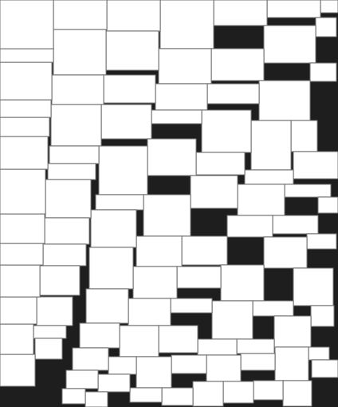<br>2.39 % dead space</td>
<td valign="top" align="center">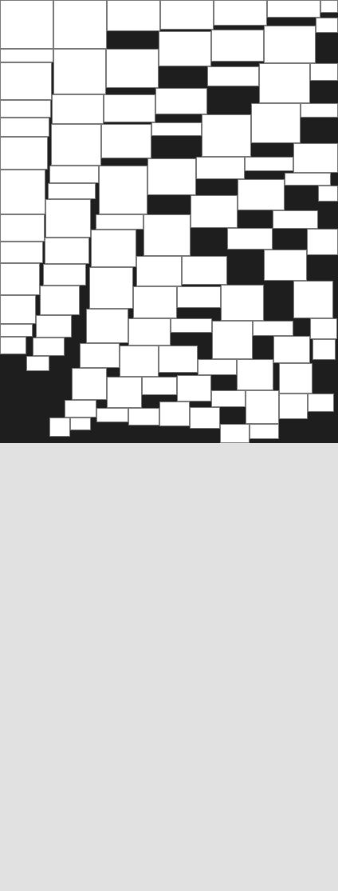<br>2.22 % dead space</td></tr>
<tr><th>n200</th>
<td valign="top" align="center">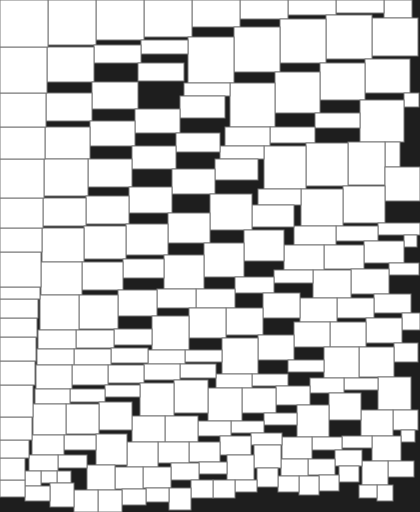<br>3.45 % dead space</td>
<td valign="top" align="center">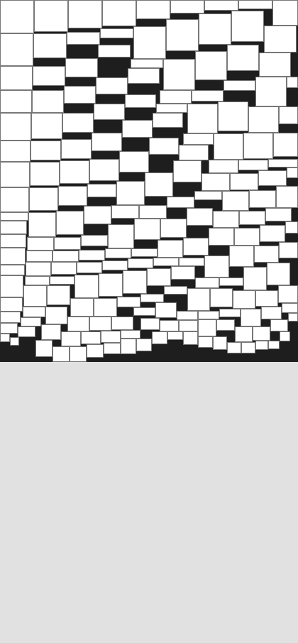<br>2.35 % dead space</td></tr>
<tr><th>n300</th>
<td valign="top" align="center">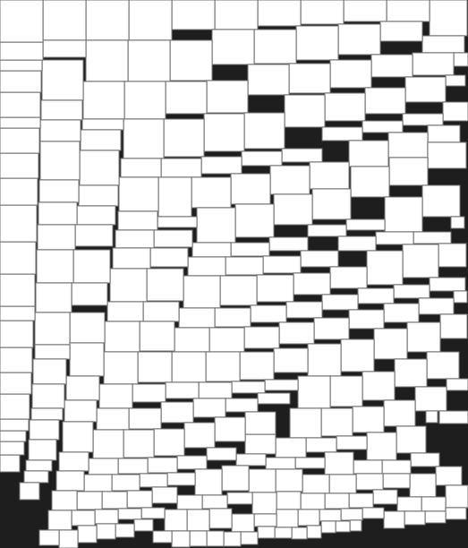<br>3.78 % dead space</td>
<td valign="top" align="center">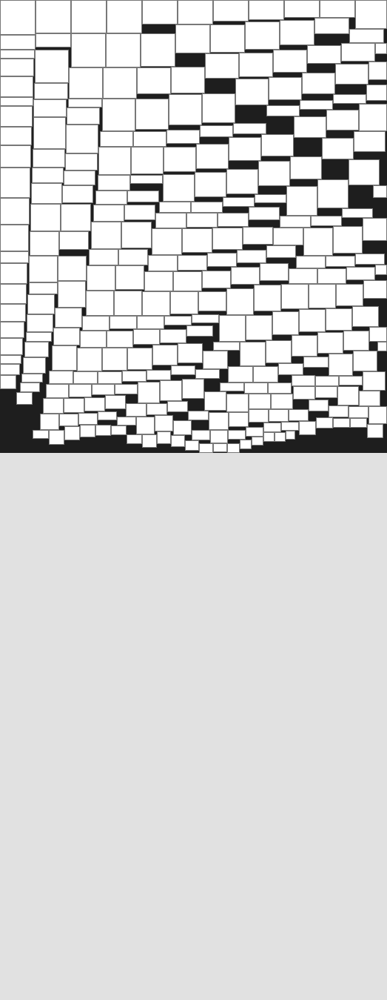<br>2.72 % dead space</td></tr>
</table>

### End results

The best floorplans shown in the original edition (with the dead space reported there) against the best floorplans of LA-POEMS in the final comparison (one-minute runs) and in the five-minute runs. For n300, the original edition reports 3.8 %, but its figure shows a floorplan with 4.37 %; the 2011 picture is therefore the final floorplan of the 2011 animation, which has 3.78 %. Both pictures of a benchmark are drawn at the same scale (the modules cover the same number of pixels), with the longer side horizontal.

<table>
<tr><th>Benchmark</th><th>2011</th><th>2026</th></tr>
<tr><th>apte</th>
<td align="center"><br>0.8 %</td>
<td align="center"><br>0.78 % (1 min)</td></tr>
<tr><th>xerox</th>
<td align="center">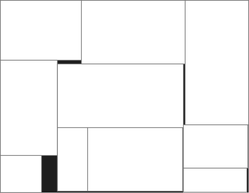<br>2.3 %</td>
<td align="center">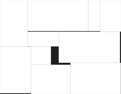<br>2.30 % (1 min)</td></tr>
<tr><th>hp</th>
<td align="center"><br>3.9 %</td>
<td align="center">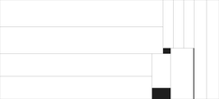<br>1.32 % (1 min)</td></tr>
<tr><th>ami33</th>
<td align="center">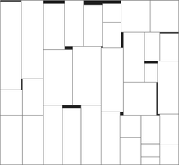<br>1.6 %</td>
<td align="center">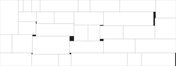<br>0.63 % (1 min)</td></tr>
<tr><th>ami49</th>
<td align="center">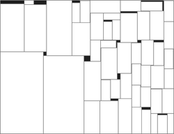<br>2.1 %</td>
<td align="center">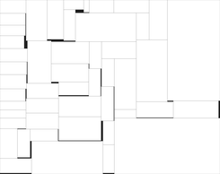<br>1.07 % (5 min)</td></tr>
<tr><th>n100</th>
<td align="center">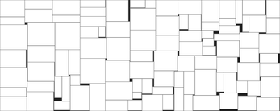<br>2.0 %</td>
<td align="center">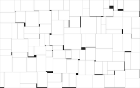<br>1.49 % (5 min)</td></tr>
<tr><th>n200</th>
<td align="center">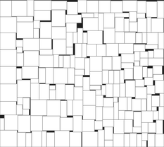<br>3.4 %</td>
<td align="center">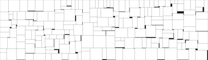<br>1.61 % (5 min)</td></tr>
<tr><th>n300</th>
<td align="center">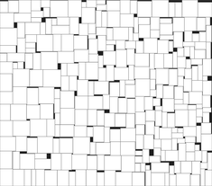<br>3.8 %</td>
<td align="center">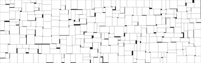<br>2.29 % (5 min)</td></tr>
</table>

Build
-----

The project is built by Maven (Java 8 or newer), which also runs the unit tests:

```bash
mvn package
java -jar target/program.jar
```

Usage
-----

Usage can be displayed by running:

```bash
java -jar program.jar
```

The first nine command line arguments are mandatory:

* input directory (expect text files with benchmarks, fixed format, see examples)
* output directory (here will be placed output directories for each benchmark)
* verbose mode (true/false)
* number of test runs
* iterations
* generations
* niché count (length of action sequences)
* niché size (number of individuals in each population niché)
* smart-fit prototype generated (true/false) 

They can be followed by these optional arguments:

* `--algorithm=poems|lapoems` the solver: POEMS with the genetic algorithm (default) or late acceptance POEMS (Chapter 3 of the revised thesis)
* `--time=SECONDS` time limit of each run (late acceptance POEMS makes I * G steps if no time limit is set)
* `--seed=NUMBER` seed of the random number generator (makes the runs reproducible)
* `--history=LENGTH` late acceptance POEMS: use late acceptance with this history length (0 = automatic) instead of simulated annealing

For late acceptance POEMS, the niche count N is the maximal number of actions in one step. The settings evaluated in the thesis are switched by Java system properties (`-Dpoems.*`, see the appendix of the thesis).

Usage example
-------------

```bash
java -jar program.jar benchmark/ benchmark/result/ true 5 1000 500 5 50 true
java -jar program.jar benchmark/ benchmark/result/ false 5 0 0 2 0 true --algorithm=lapoems --time=60
```

Benchmarking
------------

`program.Benchmark` solves a single benchmark with a fixed seed and time limit (in milliseconds) and prints one CSV line (benchmark, seed, dead space in %, unused area, total area, used area, width, height, evaluations, iterations, time, validation result). The final floorplan is always checked (all modules present once, original or rotated dimensions, no overlaps).

```bash
java -cp target/program.jar program.Benchmark benchmark/n100.txt 1 30000 1000000000 1000 3 50
java -cp target/program.jar -Dpoems.algorithm=lapoems program.Benchmark benchmark/n100.txt 1 30000 0 0 2 0
```

Animations and pictures
-----------------------

The program exports the prototype (`prototype_f.svg`) and every improvement of the best floorplan (`i_00000001.svg`, ...) into the output directory of each run. [presentation/animate.py](presentation/animate.py) (Python 3 with Pillow) makes an animated GIF of them, draws pictures of floorplans at a common scale, and sets how long the last frame of an existing GIF is shown:

```bash
python3 presentation/animate.py gif benchmark/result/n100.txt_run_0 n100.gif --frames=54 --delay=200 --pause=5000
python3 presentation/animate.py picture experiments/placements/LONG/n100_101.csv n100.png --area=47000
python3 presentation/animate.py pause presentation/n100loop.gif presentation/n100loop.gif --pause=5000
```

The 2026 animations above were made as follows (the runs are limited by the number of steps, so they are reproducible):

```bash
for b in n100:30000000 n200:20000000 n300:15000000; do
  name=${b%:*}; steps=${b#*:}
  mkdir -p anim/in_$name && cp benchmark/$name.txt anim/in_$name/
  java -jar target/program.jar anim/in_$name anim/out_$name false 1 1 $steps 2 0 true --algorithm=lapoems --seed=101
done
python3 presentation/animate.py gif anim/out_n100/n100.txt_run_0 presentation/n100_2026.gif --frames=54
python3 presentation/animate.py gif anim/out_n200/n200.txt_run_0 presentation/n200_2026.gif --frames=64
python3 presentation/animate.py gif anim/out_n300/n300.txt_run_0 presentation/n300_2026.gif --frames=67
```

The pictures of the end results are drawn by [presentation/results/make.sh](presentation/results/make.sh).

Note: You can convert SVG images to PDF using the Inkscape:

```bash
#!/bin/bash
rm *.pdf
for file in i_*.svg
do
  inkscape -z --file=${file} --export-pdf=${file}.pdf
done
```
